<picture>
  <source media="(prefers-color-scheme: dark)" srcset="docs/readme/banner-dark.png" />
  <source media="(prefers-color-scheme: light)" srcset="docs/readme/banner.png" />
  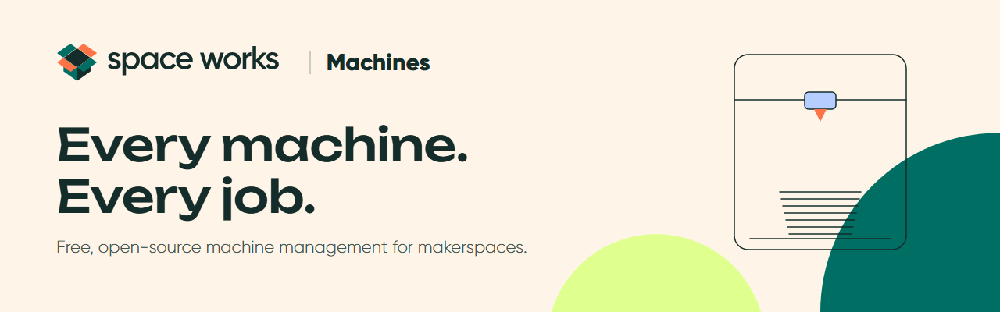
</picture>

<p align="center">
  <a href="LICENSE"></a>
  <a href="https://nextjs.org"></a>
  <a href="#quick-start-local"></a>
  <a href="docs/DEPLOYMENT_CLOUD.md"></a>
</p>

<p align="center">
  <a href="#host-it-on-a-vps-with-docker">Host on a VPS</a> ·
  <a href="#run-it-in-the-cloud">Cloud hosting</a> ·
  <a href="#quick-start-local">Quick start</a> ·
  <a href="#documentation">Documentation</a> ·
  <a href="#contributing">Contributing</a> ·
  <a href="#credits">Credits</a>
</p>

**Space Works Machines is free, open-source machine management for makerspaces, fab labs and college
workshops.** List your 3D printers, laser cutters, CNC routers and the rest. Take job requests with files and
a fair queue, price them (or keep them free), take payments online or at the desk, and keep consumables,
maintenance, faults and warranties in one place. You can also connect printers and other tools through a REST
API and webhooks. One install runs many makerspaces ("spaces"), each with its own staff, makers, machines,
prices and payment account. It's self-hosted and licensed AGPL-3.0-or-later, so your makers' data stays in
your own database.

## What you can do

Grouped the way a workshop's week actually goes.

### Machines and the public catalogue

- Machine types for FDM and resin printers, laser cutters, CNC routers and mills, vinyl cutters, PCB mills,
  soldering stations, or your own. Each type sets its own spec fields, request fields, file rules, materials
  and colours.
- A machine record for each machine, with photos, documents (manuals, SOPs, safety sheets), a status that
  always carries a word, and retirement.
- A public machine catalogue per space, `/s/<space>/machines`, that shows only what you mark public. It never
  shows notes, costs, serial numbers or meters.

### Jobs, from request to collection

- Makers request a job from a machine's page, with files checked against the type's rules. STL and G-code are
  parsed for size and slicer estimates.
- A queue with positions and an estimated wait: "#3 in the queue · 2 approved jobs ahead · about 1 h 20 min".
- Review, approve or reject, then start, pause, complete or fail, collect, reprint and add notes. Every step
  goes on a timeline, and each requester gets a private status link.
- Consumables are reserved when a job starts and reconciled when it finishes. Machine hours and job counts
  update as you go.

### Prices and payments

- Free, flat, time, material or time and material pricing, with member and public rates, minimum charges and
  tax.
- Payment upfront, on completion (with an optional deposit) or pay later. Payments go through each space's
  own Razorpay or Stripe account, or are recorded at the desk (cash, UPI, bank transfer, card terminal), with
  an optional second-person check.
- Refunds for rejected, cancelled and failed jobs follow your rules: full, a percentage, none, or decided by
  staff. Partial refunds and overpayment refunds are supported.

### Consumables, upkeep and reports

- Consumable pools for filament, resin and sheets, with an append-only ledger and low-stock alerts.
- Maintenance schedules by date, machine hours or job count, with reminders. Maintenance records with
  attachments, downtime windows, fault reports from makers and staff, warranties with expiry reminders, and a
  service history for each machine.
- Reports with CSV and Excel export: jobs (failure rate, turnaround), utilisation (hours, availability, MTBF,
  MTTR), consumables used, revenue per currency, maintenance, warranties, spend per machine and repair spend.

### Connect it to everything else

- A REST API (`/api/v1`) with per-space keys and scopes, and an OpenAPI document. See [docs/API.md](docs/API.md).
- Signed outbound webhooks for machines, jobs, payments, consumables and upkeep, with retries and a delivery
  log.
- Printer connections:
  - **Working today:** a manual connection, and a built-in simulated printer that starts with a job, reports
    temperatures and progress, and finishes the job from its telemetry.
  - **Coming soon:** OctoPrint, Moonraker/Klipper, Bambu Lab and PrusaLink.
- An audit log of every change, team chat alerts (Slack, Discord, Mattermost, Telegram, WhatsApp), and email
  through each space's own SMTP.

### Repairs, technicians and buying

- A directory of the people who fix your machines: staff technicians and outside contacts, with their skills
  and how to reach them.
- From any fault, ask one or more technicians at once. Each hears by email, plus WhatsApp or Telegram when the
  space has them set up; staff get it in their Repairs inbox and outside technicians a private link that needs
  no account. The first to accept takes the repair.
- The technician records the fix, the parts and photos, and the amount they ask; a manager checks it and closes
  it (a corrective maintenance record is written) or reopens it with a reason.
- The machine manager approves the amount and pays it in one go or in parts, by cash, bank transfer or UPI, in
  an append-only payout ledger.
- A to-buy list for parts and consumables: asked for, approved, bought (with what was actually spent) and
  received. Receiving a consumable restocks its pool.

### Finance

- Every payment in and out goes into one append-only ledger as it happens: job payments and refunds, repair
  payouts, maintenance costs, parts and consumables bought, and your own entries such as rent. Mistakes are
  corrected with a reversing entry, never by editing.
- A Finance page with money in, out and net per day, week, month or financial year (April to March), by
  category, method, machine, technician and supplier, each entry linked to where it came from, with CSV and
  Excel export.
- Spend per machine and repair spend in Reports, and this month's figures on the overview. Money is for the
  machine manager only: other roles see no totals, and a technician sees only what they asked and whether it
  was paid.

### Accounts and spaces

- Each person has one account across spaces. They sign in with a password or an emailed link, and staff need
  an authenticator app.
- Roles: machine manager (runs the whole makerspace, the team and the money), machine type manager (full
  access to the machine types they are given, nothing else), operator, technician, viewer and maker. A space
  always keeps at least one machine manager. Makers join a space freely, by approval or by invitation.
- A super admin reviews space applications, sets limits and watches instance health.

## A look around

Screens from the seeded demo, in light mode. Every page has a dark mode too; the `-dark.png` files in
[`docs/screenshots`](docs/screenshots) show it.

<table>
  <tr>
    <td width="50%">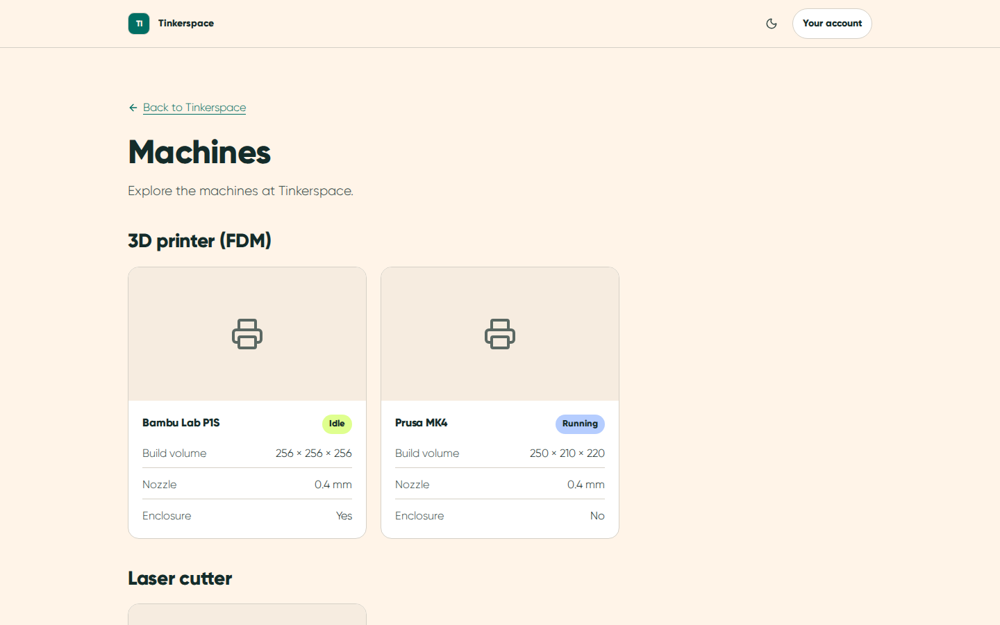<br /><sub>Public machine catalogue</sub></td>
    <td width="50%">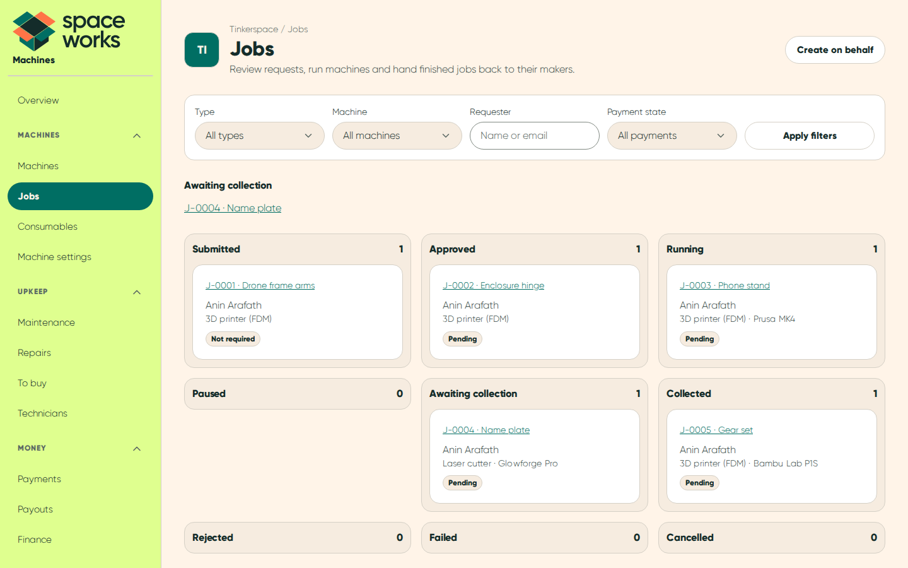<br /><sub>Job board</sub></td>
  </tr>
  <tr>
    <td>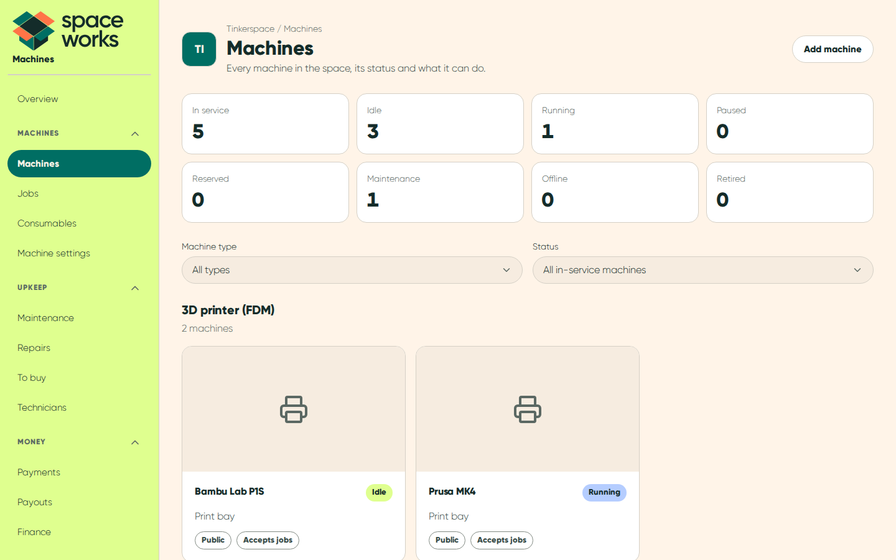<br /><sub>Machines</sub></td>
    <td>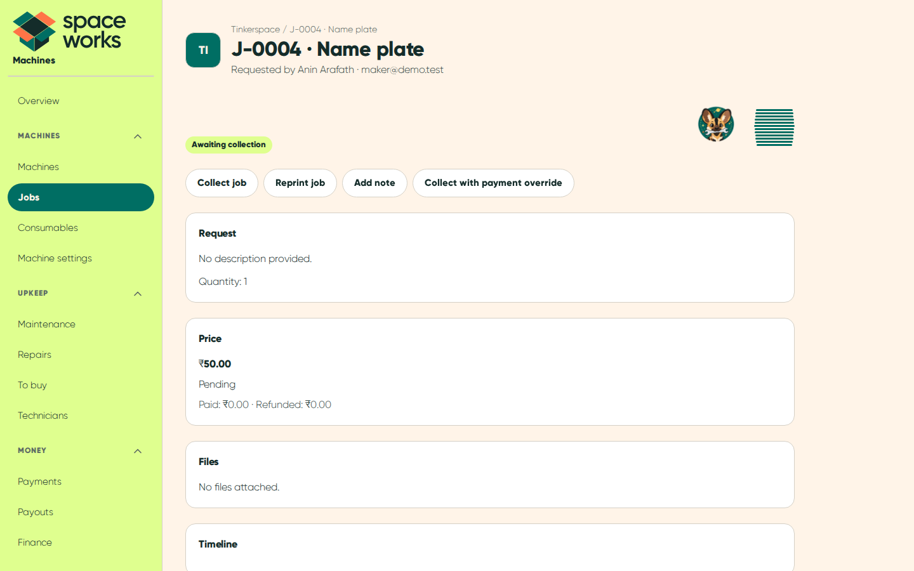<br /><sub>A finished job</sub></td>
  </tr>
  <tr>
    <td>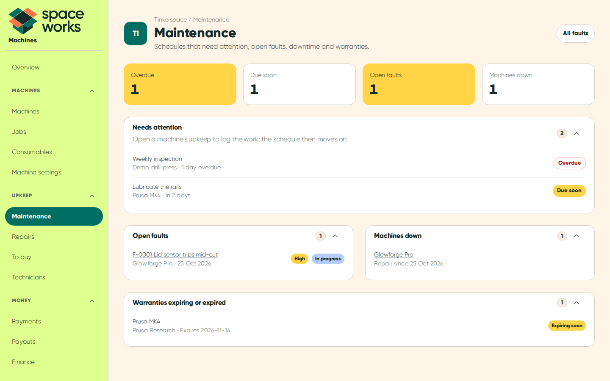<br /><sub>Maintenance</sub></td>
    <td>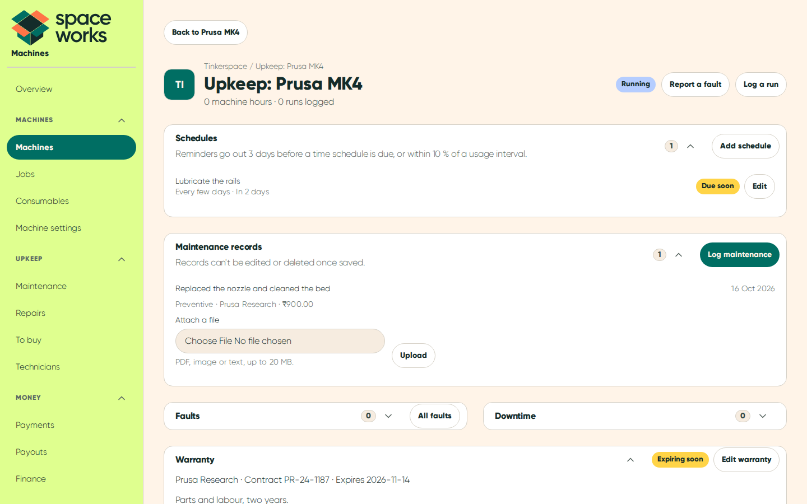<br /><sub>A machine's upkeep</sub></td>
  </tr>
  <tr>
    <td>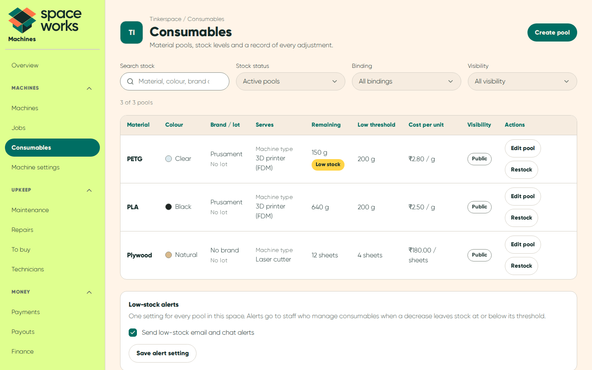<br /><sub>Consumables</sub></td>
    <td>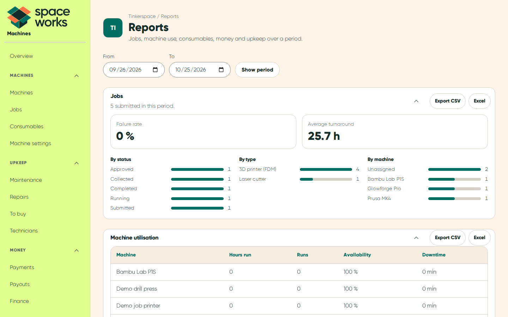<br /><sub>Reports</sub></td>
  </tr>
  <tr>
    <td>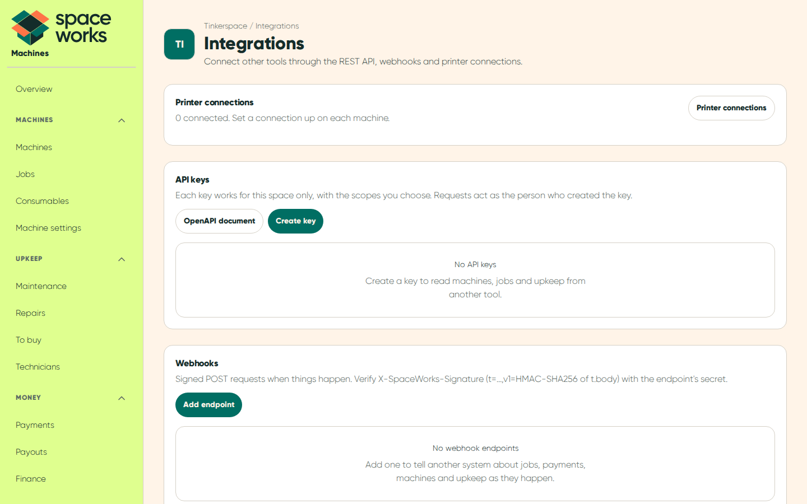<br /><sub>Integrations</sub></td>
    <td>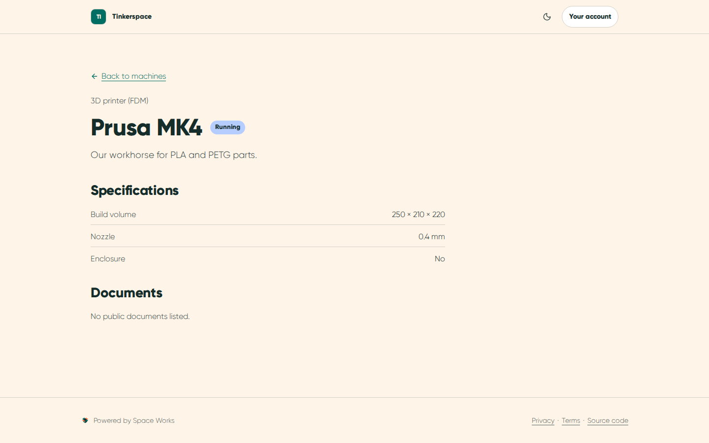<br /><sub>A public machine page</sub></td>
  </tr>
  <tr>
    <td>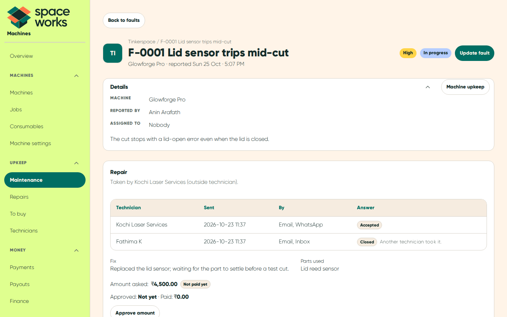<br /><sub>A repair</sub></td>
    <td>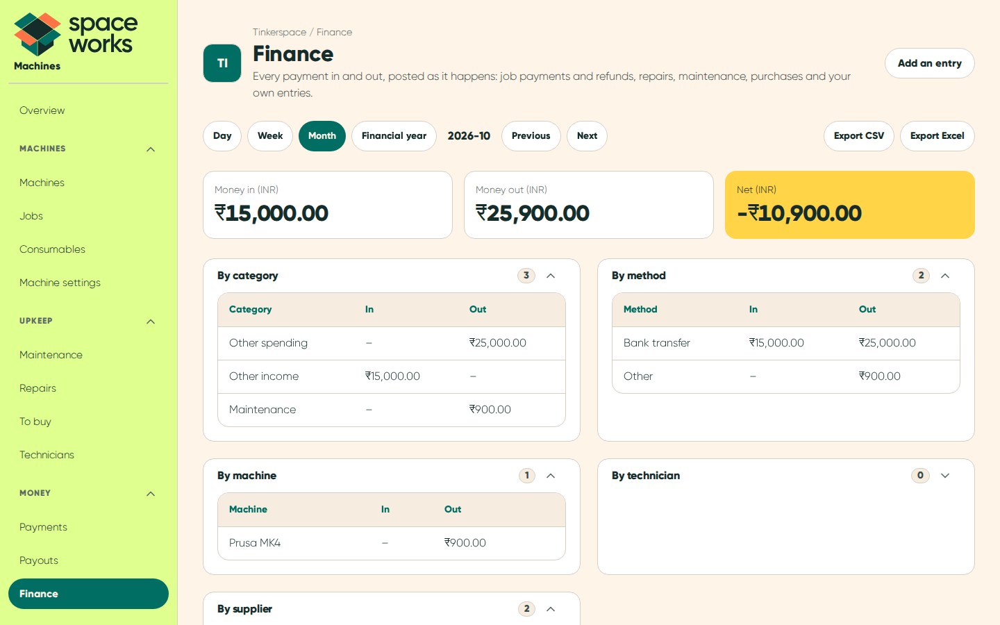<br /><sub>Finance</sub></td>
  </tr>
</table>

## Host it on a VPS with Docker

The recommended setup is one Linux server running the
production compose stack:

- the app, and a BullMQ `worker` and `beat` for email, reminders, webhooks and printer polling
- PostgreSQL 16 and Redis 7
- Silo (S3-compatible) storage
- Caddy with automatic HTTPS
- scheduled backups

### Install in one line

```bash
curl -fsSL https://raw.githubusercontent.com/SpaceWorks-HQ/SpaceWorks-Machines/main/install.sh | bash
```

The installer checks the server first and changes nothing until those checks pass. It then asks for your
address, HTTPS mode, storage, the super-admin email and an SMTP relay, and shows a summary before it installs
anything.

- **Before the first release:** build a branch from source with `--ref`, for example `--ref dev`.
- **Private repository:** set `GITHUB_TOKEN`, or fetch the installer with the GitHub CLI:

```bash
gh api "repos/SpaceWorks-HQ/SpaceWorks-Machines/contents/install.sh?ref=dev" -H "Accept: application/vnd.github.raw" | bash -s -- --ref dev
```

Everything about the server install is in [docs/DEPLOYMENT_VPS.md](docs/DEPLOYMENT_VPS.md).

### Update, back up and check

Run the installer again to update, back up or roll back: it detects the existing install. On the server:

```bash
bash scripts/update.sh --force                     # latest release (backs up first)
bash scripts/backup.sh                             # database dump into backups/
bash scripts/restore.sh backups/<dump>.sql.gz      # restore one
scripts/spaceworks-compose.sh bundled run --rm ops # operator checks
bash scripts/admin.sh create --email you@example.org   # super admins are made on the server only
```

### Should I split the frontend?

Usually not. One server keeps everything together. If you want the website on Netlify and the backend on
your server, the split image talks to the backend only through a signed gateway and holds no database, mail
or storage credentials. See [docs/DEPLOYMENT_NETLIFY.md](docs/DEPLOYMENT_NETLIFY.md).

## Run it in the cloud

[](https://render.com/deploy?repo=https://github.com/SpaceWorks-HQ/SpaceWorks-Machines)

[`render.yaml`](render.yaml) is a Render Blueprint for the web service plus the worker and beat (Render
starter instances). You bring the managed services:

- PostgreSQL with TLS (Supabase or any provider)
- Redis over TLS (for example Upstash)
- an S3 or R2 bucket
- an SMTP relay

Each of these has a free tier somewhere. The full walk-through is in
[docs/DEPLOYMENT_CLOUD.md](docs/DEPLOYMENT_CLOUD.md).

## Quick start (local)

Needs Node.js 22 or later and Docker (for PostgreSQL and Redis).

```bash
npm ci
docker compose up -d          # PostgreSQL 16 and Redis 7 on localhost
cp .env.example .env          # then set AUTH_SECRET (openssl rand -base64 32) and the keys it lists
npm run db:deploy             # apply the migrations
DEMO_PASSWORD='a-long-password' npm run db:seed-demo   # optional: the Tinkerspace demo
npm run dev                   # http://localhost:3000
```

Background jobs run in their own processes (`npm run build:jobs`, then `npm run worker` and `npm run beat`).
Without Redis, set `JOBS_INPROCESS=true` to deliver email from the web process instead.

## Design system

Space Works Machines follows [SpaceWorks-Design](https://spaceworks-hq.github.io/SpaceWorks-Design/), the
only source of brand truth:

- tokens for every colour, and light and dark modes; switching reveals the new mode in a circle from the
  toggle
- the free Gilroy weights, with Unbounded for one accent phrase per layout
- pill-shaped controls
- Patch the painted wolf, with a few easter eggs

The details are in [docs/DESIGN.md](docs/DESIGN.md).

## Documentation

| Guide | What's in it |
| --- | --- |
| [docs/DEPLOYMENT_VPS.md](docs/DEPLOYMENT_VPS.md) | The one-line install, what runs, backups, updates, certificates |
| [docs/DEPLOYMENT_CLOUD.md](docs/DEPLOYMENT_CLOUD.md) | Render and managed services |
| [docs/DEPLOYMENT_NETLIFY.md](docs/DEPLOYMENT_NETLIFY.md) | Split hosting: the website on Netlify |
| [docs/CONFIGURATION.md](docs/CONFIGURATION.md) | Every environment variable |
| [docs/ARCHITECTURE.md](docs/ARCHITECTURE.md) | How the app is put together |
| [docs/JOBS.md](docs/JOBS.md) | Jobs, pricing and payments in the code |
| [docs/API.md](docs/API.md) | REST API, webhooks and printer connections |
| [docs/SECURITY.md](docs/SECURITY.md) | Accounts, sign-in and data protection |
| [docs/NOTIFICATIONS.md](docs/NOTIFICATIONS.md) | Email and chat alerts |
| [docs/DESIGN.md](docs/DESIGN.md) | Brand, components, Patch and the easter eggs |
| [docs/DECISIONS.md](docs/DECISIONS.md) | Every decision: locked, the owner's, defaults and checks still to do |
| [CHANGELOG.md](CHANGELOG.md) | What changed in each version |

## Common commands

```bash
npm run lint               # ESLint
npm run typecheck          # TypeScript
npm run test:unit          # Vitest unit tests
npm run test:integration   # PostgreSQL integration tests (TEST_DATABASE_URL: a disposable database)
npm run test:e2e           # Playwright journeys (seed the demo, set DEMO_PASSWORD and DEMO_MFA_SECRET)
npm run test:e2e:vps       # production build, whole-server layout
npm run test:e2e:split     # production build, split frontend and backend
npm run build              # production build
npm run readme:art         # redraw the README banners
npm run readme:screens     # retake the README screenshots from the seeded demo
```

## Contributing

Issues and pull requests are welcome. Branch from `dev` and open pull requests into `dev`; only the
maintainer merges into `main`. Keep files under 300 lines, scope every query to its space, check
capabilities rather than role names, and run the checks above before you push. [CLAUDE.md](CLAUDE.md) (the
same as [AGENTS.md](AGENTS.md)) has the full conventions, and [docs/DECISIONS.md](docs/DECISIONS.md) records why
things are the way they are.

## Credits

- **Platform layer:** forked from
  [Space Works Organization](https://github.com/SpaceWorks-HQ/SpaceWorks-Organization) 0.7.0, which itself
  builds on [Space Works Events](https://github.com/SpaceWorks-HQ/SpaceWorks-Events).
- **Background jobs:** the BullMQ worker and beat follow
  [Space Works Workspace](https://github.com/SpaceWorks-HQ/SpaceWorks-Workspace).
- **Domain:** the rules for machines, printing, maintenance and payments are ported from the Django
  [SpaceWorks](https://github.com/SpaceWorks-HQ/SpaceWorks) apps.
- **Brand:** the name, logo, Patch and visual identity come from
  [SpaceWorks-Design](https://github.com/SpaceWorks-HQ/SpaceWorks-Design).
- **Fonts:** Gilroy Light and ExtraBold by Radomir Tinkov (Gilroy Free Font EULA), and Unbounded (SIL Open
  Font License 1.1). See [NOTICE](NOTICE).

## Licence

Space Works Machines is free software under the GNU Affero General Public License, version 3 or (at your
option) any later version. See [LICENSE](LICENSE). If you run a modified version for others over a network,
you must offer them its source code.
